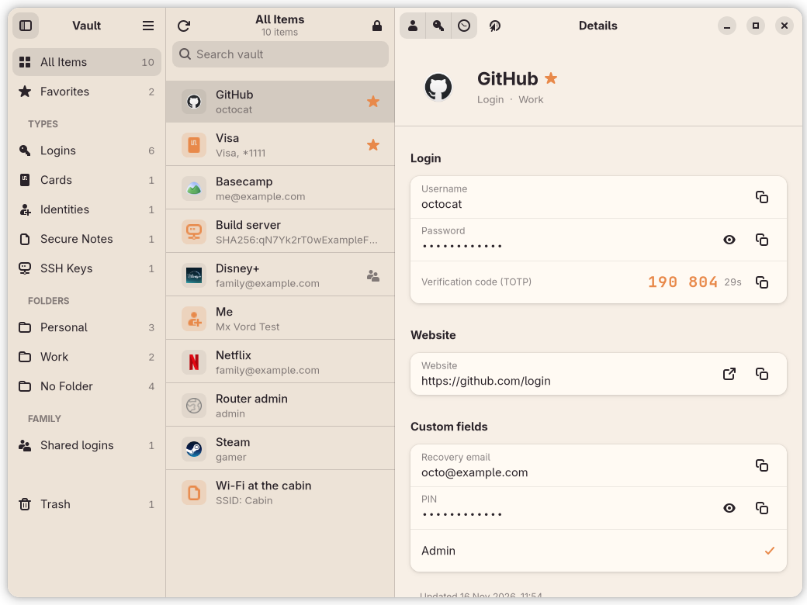

# Vord

*Vörðr* (Old Norse): a warden spirit that follows a person through life and
guards them. A fitting name for the app that keeps your passwords.

Vord is a native vault for [Vaultwarden](https://github.com/dani-garcia/vaultwarden)
and Bitwarden on the Linux desktop, built with GTK 4 and libadwaita and written
in Rust. It looks like its siblings (Rustle, Bubo, Gaze) and follows the
Omarchy theme live.



## Features

- Three panes: the vault (All Items, Favorites, types, folders, organization
  collections, Trash), the items, and the selected item.
- Logins, cards, identities, secure notes, SSH keys and custom fields, with
  copy buttons and reveal toggles; secrets start hidden.
- Live TOTP codes with a countdown, including Steam Guard codes.
- Search across names, usernames, websites and card brands.
- Website icons from your own server's icon service (nothing goes to a third
  party). They can be turned off.
- Copied secrets are marked so clipboard histories skip them, and the
  clipboard is emptied after 30 seconds (configurable).
- Locks after 15 minutes in the background (configurable), when the screen
  locks (logind and Omarchy's lock screen), before sleep, and with Ctrl+L.
- Honours Bitwarden's "master password re-prompt" on protected items.
- Works offline: unlocking needs no network. The vault syncs on unlock, every
  10 minutes and with Ctrl+R.
- Organization items, including per-item keys.
- A generator for passwords, passphrases and usernames (random word,
  plus-addressed or catch-all email), with Bitwarden's options. What you copy
  from it is listed under History until the vault locks; `vord generate` makes
  one from the terminal.
- Two-step login with an authenticator app, an emailed code or a YubiKey
  (OTP), and "remember this device".
- Creating and editing every item type, in your own vault or an
  organization's collections: websites, custom fields, notes, folder,
  favorite and re-prompt. A new SSH key item gets a freshly made Ed25519 key.
- A changed password goes into the item's password history (the last five,
  shown under the item), as do a hidden field's old values.
- Cloning, moving to the Trash, restoring and deleting for good; creating,
  renaming and deleting folders.
- Saving changes only what you changed. Passkeys, attachments and anything
  Vord doesn't show yet are kept as they are, and a save made over a copy
  that changed elsewhere is refused rather than overwriting it.

## Roadmap

The aim is to do what the Bitwarden desktop app does, in this order:

1. ~~Two-step login with an authenticator app, email or a YubiKey.~~ Done.
2. ~~Password, passphrase and username generator.~~ Done.
3. Creating and editing items. Done: every item type, folders, favorites,
   cloning, the Trash, password history. Still to do: moving an item from
   your own vault into an organization, and changing an existing item's
   collections.
4. Attachments: downloading and uploading them.
5. Sends: sharing text and files by link.
6. Unlocking with a PIN, exporting the vault, syncing the moment something
   changes on the server, an SSH agent for the vault's SSH keys, more than
   one account, and a tray icon.
7. Two-step login with Duo or a FIDO2 security key, logging in by approving
   from another device, and SSO.

Until then:

- Move an item into an organization, or change its collections, in the web
  vault or another Bitwarden app; Vord picks the change up on its next sync.
- Attachments are listed by name but can't be opened.
- An account whose only second step is Duo or a FIDO2 key gets a clear error
  at login; one that also has an authenticator app or email can use those.
- SSO and Key Connector accounts can't log in.

Not on the list yet: forwarded email aliases (SimpleLogin, addy.io and the
like) in the username generator, auto-type, and unlocking browser extensions
with Vord.

## Keyboard

| Key | Action |
| --- | --- |
| Ctrl+F | Search |
| Ctrl+N | New login (the + button has the other types) |
| Ctrl+E | Edit the item |
| Ctrl+S | Save the item being edited |
| Ctrl+G | Generator |
| Ctrl+U | Copy the username |
| Ctrl+P | Copy the password |
| Ctrl+T | Copy the verification code |
| Ctrl+O | Open the website |
| Ctrl+R / F5 | Sync now |
| Ctrl+L | Lock |
| Ctrl+, | Preferences |
| Ctrl+Q | Quit |

## Security

Vord follows the Bitwarden client protocol and does all decryption locally:

- The master key comes from your master password with the account's own key
  derivation (PBKDF2-SHA256 or Argon2id). The server only ever receives a hash
  of it, the same one every Bitwarden app sends.
- Vault data is AES-256-CBC with HMAC-SHA256. MACs are checked, in constant
  time, before anything is decrypted. Organization keys are RSA-OAEP.
- On disk, `~/.local/share/vord` (mode 0700, files 0600) holds the server, the
  email, the KDF settings, the session's refresh token, and the vault exactly
  as the server sent it, still encrypted. This is what the official desktop
  app keeps too, and it is why unlocking works offline. Nothing decrypted is
  ever written.
- `device.json` there holds this device's id and, if you ticked "Remember
  this device", the server's token for skipping two-step login. Like the
  official apps, Vord keeps it when you log out; delete the file to forget
  the device.
- Changes are encrypted on your machine, with the item's own key when it has
  one, before they're sent. Fields you didn't change keep their ciphertext.
  Websites carry the checksum Bitwarden's apps use to notice a URI swapped
  by a server.
- Keys are zeroed when the vault locks, and every widget that showed
  decrypted text is destroyed, including an editor with unsaved changes.

The crypto is checked against values computed independently with Node's
`crypto` module (`tests/vectors.js`) and the RFC 6238 TOTP vectors, and
end to end against a real Vaultwarden (`tests/seed.js`). Items Vord saves
are checked to open in Bitwarden's own web vault.

## Install

Needs GTK ≥ 4.18, libadwaita ≥ 1.8 and a Rust toolchain.

```sh
sh install.sh               # ~/.local; PREFIX=/usr for system-wide
sh uninstall.sh
```

Then open **Vord** from the app launcher and log in with your server's address
(for example `https://vault.example.com`), your email and your master
password.

## Theming

With "Follow Omarchy theme" on (the default), Vord takes its colours from the
current Omarchy theme and changes with it. A theme can also ship a `vord.css`,
layered over the derived palette. For example, to make the sidebars
translucent:

```css
:root { --vord-sidebar-opacity: 0.85; }
```

## Licence

GPL-3.0-or-later.

Passphrases and usernames use the [EFF long word list](https://www.eff.org/dice)
(`data/eff_large_wordlist.txt`), by the Electronic Frontier Foundation, under
CC BY 3.0 US.
